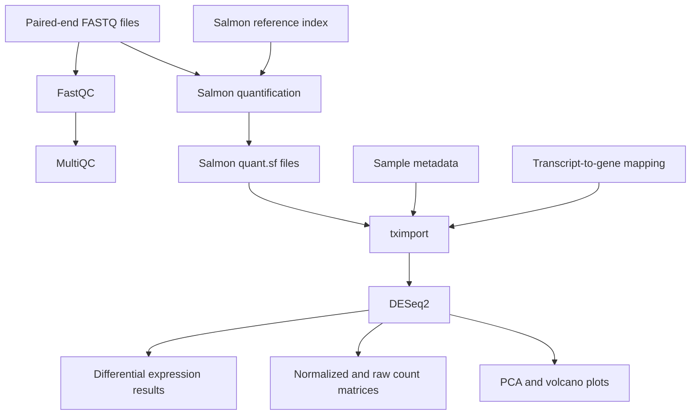

# Drosophila melanogaster RNA-seq Analysis with Nextflow

A reproducible bulk RNA-seq workflow for analysing gene-expression differences between *Drosophila melanogaster* samples maintained at 21°C and 29°C.

The workflow uses Nextflow DSL2, Docker, FastQC, MultiQC, Salmon, tximport and DESeq2. It performs read-quality assessment, transcript-level quantification and gene-level differential expression analysis.

## Project overview

This project analyses six paired-end RNA-seq samples from the Maine population of *D. melanogaster*, with three biological replicates per temperature condition.

| Condition | Biological replicates | SRA accessions |
|---|---:|---|
| 21°C | 3 | SRR1576457, SRR1576458, SRR1576459 |
| 29°C | 3 | SRR1576460, SRR1576461, SRR1576462 |

The analysis compares expression at 29°C against 21°C.

## Study and data source

The sequencing data are associated with:

Zhao et al. (2015). *Parallel Gene Expression Differences between Low and High Latitude Populations of Drosophila melanogaster and D. simulans*. PLOS Genetics.

- [Publication](https://journals.plos.org/plosgenetics/article?id=10.1371/journal.pgen.1005184)
- [PubMed Central article](https://pmc.ncbi.nlm.nih.gov/articles/PMC4423912/)
- Sequencing data: publicly available through [NCBI SRA](https://www.ncbi.nlm.nih.gov/sra) and the [European Nucleotide Archive (ENA)](https://www.ebi.ac.uk/ena/browser/home).

| Sample group | Run accession | Read 1 | Read 2 | ENA record |
|---|---|---|---|---|
| 21°C replicate 1 | SRR1576457 | [Download](https://ftp.sra.ebi.ac.uk/vol1/fastq/SRR157/007/SRR1576457/SRR1576457_1.fastq.gz) | [Download](https://ftp.sra.ebi.ac.uk/vol1/fastq/SRR157/007/SRR1576457/SRR1576457_2.fastq.gz) | [ENA record](https://www.ebi.ac.uk/ena/browser/view/SRR1576457) |
| 21°C replicate 2 | SRR1576458 | [Download](https://ftp.sra.ebi.ac.uk/vol1/fastq/SRR157/008/SRR1576458/SRR1576458_1.fastq.gz) | [Download](https://ftp.sra.ebi.ac.uk/vol1/fastq/SRR157/008/SRR1576458/SRR1576458_2.fastq.gz) | [ENA record](https://www.ebi.ac.uk/ena/browser/view/SRR1576458) |
| 21°C replicate 3 | SRR1576459 | [Download](https://ftp.sra.ebi.ac.uk/vol1/fastq/SRR157/009/SRR1576459/SRR1576459_1.fastq.gz) | [Download](https://ftp.sra.ebi.ac.uk/vol1/fastq/SRR157/009/SRR1576459/SRR1576459_2.fastq.gz) | [ENA record](https://www.ebi.ac.uk/ena/browser/view/SRR1576459) |
| 29°C replicate 1 | SRR1576460 | [Download](https://ftp.sra.ebi.ac.uk/vol1/fastq/SRR157/000/SRR1576460/SRR1576460_1.fastq.gz) | [Download](https://ftp.sra.ebi.ac.uk/vol1/fastq/SRR157/000/SRR1576460/SRR1576460_2.fastq.gz) | [ENA record](https://www.ebi.ac.uk/ena/browser/view/SRR1576460) |
| 29°C replicate 2 | SRR1576461 | [Download](https://ftp.sra.ebi.ac.uk/vol1/fastq/SRR157/001/SRR1576461/SRR1576461_1.fastq.gz) | [Download](https://ftp.sra.ebi.ac.uk/vol1/fastq/SRR157/001/SRR1576461/SRR1576461_2.fastq.gz) | [ENA record](https://www.ebi.ac.uk/ena/browser/view/SRR1576461) |
| 29°C replicate 3 | SRR1576462 | [Download](https://ftp.sra.ebi.ac.uk/vol1/fastq/SRR157/002/SRR1576462/SRR1576462_1.fastq.gz) | [Download](https://ftp.sra.ebi.ac.uk/vol1/fastq/SRR157/002/SRR1576462/SRR1576462_2.fastq.gz) | [ENA record](https://www.ebi.ac.uk/ena/browser/view/SRR1576462) |

Reference resources:
- *Drosophila melanogaster* reference genome and annotation: [FlyBase r6.69 archive (FB2026_03)](https://s3ftp.flybase.org/genomes/Drosophila_melanogaster/dmel_r6.69_FB2026_03/index.html).
- Reference files are available in the archive's [FASTA](https://s3ftp.flybase.org/genomes/Drosophila_melanogaster/dmel_r6.69_FB2026_03/fasta/), [GFF](https://s3ftp.flybase.org/genomes/Drosophila_melanogaster/dmel_r6.69_FB2026_03/gff/) and [GTF](https://s3ftp.flybase.org/genomes/Drosophila_melanogaster/dmel_r6.69_FB2026_03/gtf/) directories.
- Transcript-to-gene mapping: `tx2gene.tsv`, generated from the corresponding reference annotation.

## Workflow



### Pipeline stages

1. **FastQC** — evaluates read quality for all paired-end FASTQ files.
2. **MultiQC** — aggregates FastQC reports into a consolidated quality-control report.
3. **Salmon** — performs transcript-level quantification using selective alignment and sequence and GC-bias correction.
4. **tximport** — imports Salmon estimates and summarizes transcript-level quantification to genes.
5. **DESeq2** — performs gene-level differential expression analysis using a temperature-based design.

The DESeq2 comparison is:

`29°C versus 21°C`

Low-count genes are filtered using the criterion that a gene must have at least 10 counts in at least three samples.

## Repository structure

```text
.
├── main.nf
├── nextflow.config
├── Dockerfile.deseq2
├── README.md
├── .gitignore
│
├── scripts/
│   ├── deseq2.R
│   └── download_remaining_fastq.sh
│
├── data/
│   └── metadata/
│       ├── samplesheet.csv
│       ├── ena_run_metadata.tsv
│       ├── ena_sample_details.tsv
│       └── ena_fastq_checksums.tsv
│
├── results/
│   ├── fastqc/
│   ├── multiqc/
│   ├── salmon/
│   │   └── quant/
│   └── deseq2/
│       ├── differential_expression.csv
│       ├── gene_counts_raw.csv
│       ├── gene_counts_normalized.csv
│       ├── sample_metadata.csv
│       ├── sessionInfo.txt
│       ├── summary.txt
│       └── plots/
│           ├── pca.png
│           └── volcano.png
│
└── logs/
    ├── final_pipeline_report.html
    ├── final_pipeline_timeline.html
    └── final_pipeline_trace.tsv
```

Large input data, reference assets, the Salmon index and temporary Nextflow execution files are excluded from version control. They must be obtained or regenerated before running the workflow.

## Requirements

- Linux or WSL2 with Ubuntu
- Java, as required by Nextflow
- Nextflow
- Docker Engine
- Sufficient disk space for FASTQ files, reference assets, index files and intermediate results

The workflow uses these container images:

| Component | Container image |
|---|---|
| FastQC | `staphb/fastqc:0.12.1` |
| MultiQC | `multiqc/multiqc:v1.35` |
| Salmon | `combinelab/salmon:1.10.3` |
| DESeq2 environment | Locally built `rnaseq-deseq2:1.0` |

The DESeq2 container is built from `bioconductor/bioconductor_docker:RELEASE_3_21` and installs tximport, DESeq2 and ggplot2.

## Input preparation

Before running the workflow, prepare the following files and directories:

1. Paired-end FASTQ files for all six SRA runs, placed under `data/raw/`.
2. A samplesheet at `data/metadata/samplesheet.csv`, with the expected sample metadata and FASTQ paths.
3. The FlyBase r6.69 reference assets under `data/reference/flybase_r6.69/`, including `tx2gene.tsv`.
4. A Salmon index at `results/salmon/flybase_r6.69_index/`, built from the corresponding reference transcriptome and decoy-aware reference files.

The samplesheet must contain these columns:

`sample, run_accession, population, temperature, replicate, fastq_1, fastq_2`

The download helper script is provided at `scripts/download_remaining_fastq.sh`. Review its manifest assumptions and the ENA metadata before using it.

## Running the workflow

Build the local DESeq2 container from the repository root:

```bash
docker build -f Dockerfile.deseq2 -t rnaseq-deseq2:1.0 .
```

Run the Nextflow workflow:

```bash
nextflow run main.nf
```

The workflow configuration enables Docker and limits local process concurrency to two tasks.

## Results

The completed analysis generated:

| Output | Description |
|---|---|
| `results/fastqc/` | Per-sample FastQC reports |
| `results/multiqc/multiqc_report.html` | Aggregated quality-control report |
| `results/salmon/quant/` | Per-sample Salmon quantification |
| `results/deseq2/differential_expression.csv` | Differential expression statistics |
| `results/deseq2/gene_counts_raw.csv` | Raw gene count matrix |
| `results/deseq2/gene_counts_normalized.csv` | Normalized gene count matrix |
| `results/deseq2/plots/pca.png` | Principal component analysis |
| `results/deseq2/plots/volcano.png` | Differential expression volcano plot |
| `results/deseq2/sessionInfo.txt` | R and package session information |

### Preliminary analysis summary

The completed run reported:

| Metric | Result |
|---|---:|
| Genes tested | 12,523 |
| Genes with adjusted p-value < 0.05 | 1,420 |
| Higher expression at 29°C | 759 |
| Lower expression at 29°C | 661 |

These are preliminary statistical results. Biological interpretation should be supported by sample-level quality assessment, inspection of PCA and potential outliers, gene annotation and appropriate functional enrichment analysis.

## Reproducibility

The repository preserves the workflow source, configuration, sample metadata, analysis scripts, quality-control outputs, quantification results and differential expression outputs.

Large sequencing inputs and reference assets are intentionally not committed to Git. Reproducing the analysis requires obtaining the original data and the matching reference resources, then rebuilding the Salmon index.

The DESeq2 analysis also records the R session information in `results/deseq2/sessionInfo.txt`.

## Acknowledgements

This workflow uses publicly available sequencing data and reference resources from NCBI SRA/ENA and FlyBase. It also relies on the Nextflow, FastQC, MultiQC, Salmon, tximport and DESeq2 projects.

## Citation

If you use the underlying dataset, please cite the original study:

Zhao et al. (2015). *Parallel Gene Expression Differences between Low and High Latitude Populations of Drosophila melanogaster and D. simulans*. PLOS Genetics.
